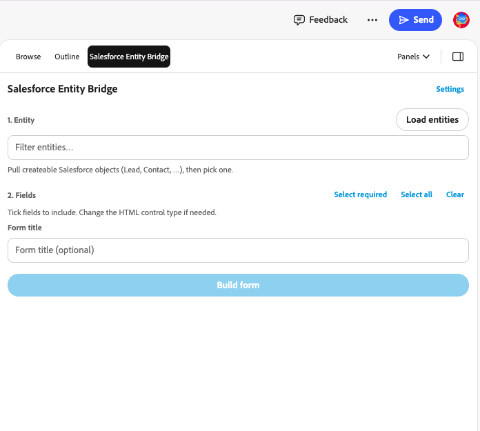
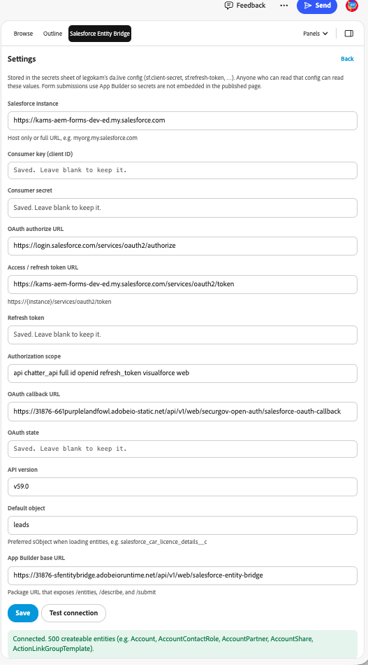
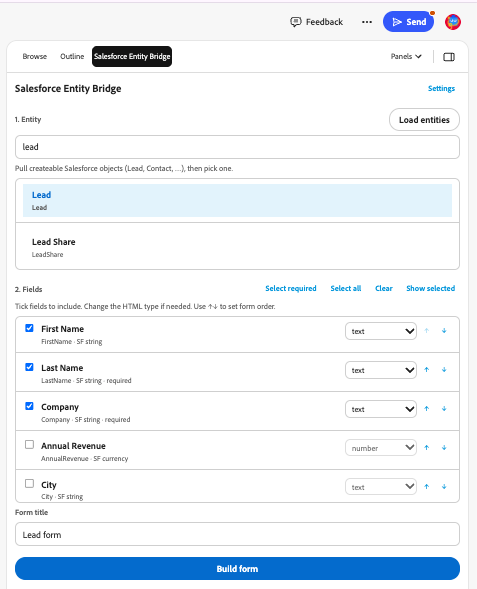
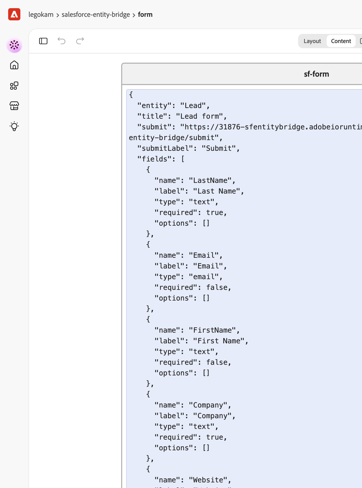
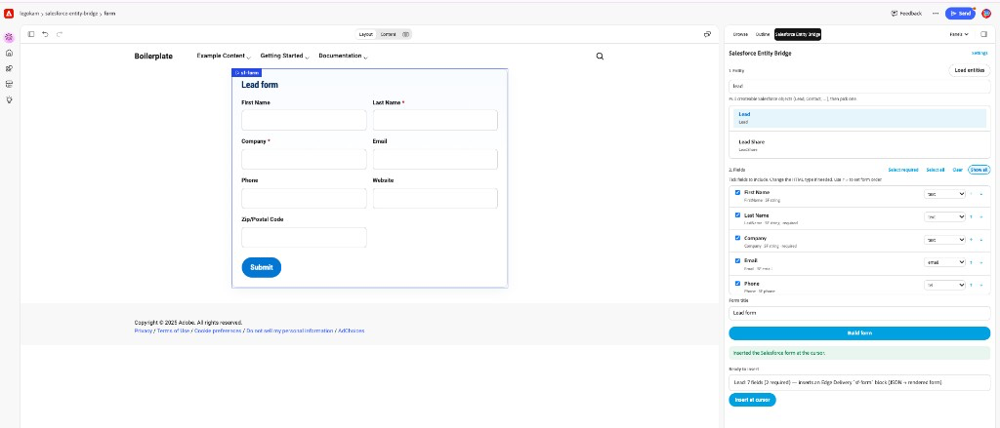
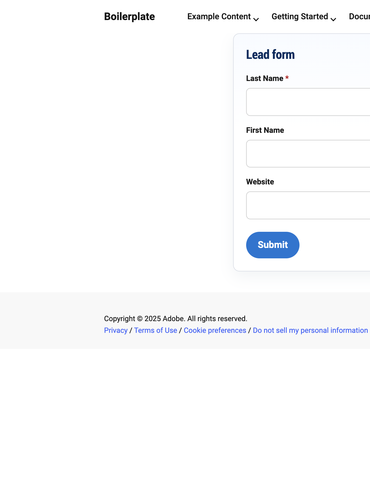
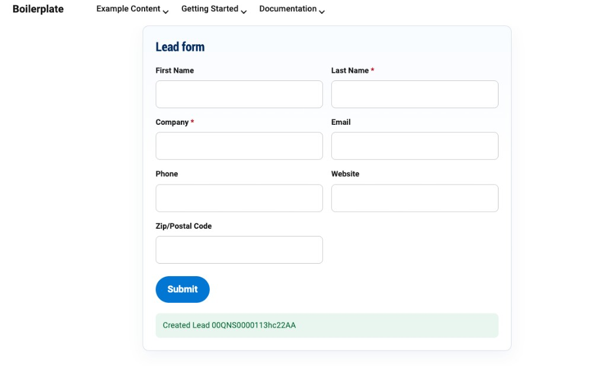
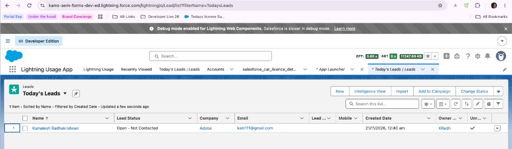

# Salesforce Entity Bridge — Experience Workspace plugin

An Edge Delivery Services / Experience Workspace plugin that connects to Salesforce, lists createable entities (Lead, Contact, …), lets authors pick fields and HTML control types, then inserts an Edge Delivery **`sf-form`** block. The block stores a JSON definition; on the published page it renders a presentable form. Submissions go to Salesforce through **Adobe App Builder** (I/O Runtime).

Credentials live in the organisation’s da.live **secrets** sheet and in App Builder `.env` — never in page content or git.

| | |
| --- | --- |
| Preview | https://main--salesforce-entity-bridge--LegoKam.aem.page/ |
| Live | https://main--salesforce-entity-bridge--LegoKam.aem.live/ |
| Demo form | https://main--salesforce-entity-bridge--LegoKam.aem.page/form |
| Canvas | https://da.live/canvas#/legokam/salesforce-entity-bridge/form |

Plugin: [`tools/salesforce-entity-bridge/`](tools/salesforce-entity-bridge/) · Block: [`blocks/sf-form/`](blocks/sf-form/) · Runtime: [`appbuilder/`](appbuilder/)

---

## Walkthrough

### 1. Open the plugin

In Experience Workspace, open **Panels → Extensions → Salesforce Entity Bridge**.



### 2. Configure settings

Open **Settings**. Salesforce Connected App values and the App Builder base URL are stored in the org’s da.live config (`secrets` sheet). Use **Test connection** to verify Runtime can list createable sObjects.



### 3. Choose an entity and fields

**Load entities**, filter (e.g. `lead`), select **Lead**, tick fields, and set a form title. Use **↑↓** to order fields; **Show selected** filters to checked fields so reordering is easier. Then **Build form**.



### 4. Insert an Edge Delivery `sf-form` block

**Insert at cursor** writes a DA authoring table whose first row is the block name `sf-form`. The body cell holds JSON (`entity`, `title`, `submit`, `fields`). In **Content** view:



### 5. Authoring preview

Switch to **Layout** view — the same block decorates into the interactive Lead form while you edit.



### 6. Published form

On the Edge Delivery preview / live site, visitors see the presentable form (two-column grid, required markers, Salesforce-styled submit).



### 7. Submit → Salesforce

Submit posts JSON to App Builder `/submit`. On success the form shows the created record id.



The Lead appears in Salesforce (e.g. Today’s Leads).



---

## What you get

- **Settings** — Salesforce Connected App + App Builder URL in da.live `secrets`
- **Load entities / describe** — createable sObjects and fields via App Builder
- **Field picker** — choose fields, HTML types, **Show selected**, and ↑↓ order
- **Insert `sf-form`** — Edge Delivery authoring table + JSON definition
- **Runtime submit** — creates Salesforce records without exposing secrets on the page

## Architecture

```
Authoring (da.live canvas)
  Plugin → App Builder /entities + /describe → Salesforce

Published site
  sf-form (JSON → HTML form) → App Builder /submit → Salesforce create

Bootstrap refresh token
  Browser → Salesforce authorize → App Builder /oauth-callback → .env
```

`submit` follows securgov `demo-open-auth` patterns: AEM Forms `data` / multipart extraction, field allowlisting, and `{ status, id, message }` responses.

### Inserted block shape

DA receives an authoring table (first row = block name):

| `sf-form` |
| `{ "entity": "Lead", "title": "Lead form", "submit": "https://…/submit", "fields": [ … ] }` |

On the page that becomes `<div class="sf-form">…</div>`. `blocks/sf-form` parses the JSON and renders the form.

---

## Install

### 1. Clone and run locally

```sh
git clone https://github.com/LegoKam/salesforce-entity-bridge.git
cd salesforce-entity-bridge
npm i
npx -y @adobe/aem-cli up
```

Plugin: `http://localhost:3000/tools/salesforce-entity-bridge/salesforce-entity-bridge.html`

### 2. Deploy App Builder actions

Adobe I/O **App Builder** project **SfEntityBridge** (Production):

| | |
| --- | --- |
| Runtime | `https://31876-sfentitybridge.adobeioruntime.net` |
| Package base | `https://31876-sfentitybridge.adobeioruntime.net/api/v1/web/salesforce-entity-bridge` |
| OAuth callback | `https://31876-sfentitybridge.adobeio-static.net/api/v1/web/salesforce-entity-bridge/oauth-callback` |

See [`appbuilder/README.md`](appbuilder/README.md). From `appbuilder/`: configure `.env`, then `aio app deploy`.

Do **not** duplicate `Access-Control-*` headers in action responses — Runtime’s gateway already adds CORS. Duplicates become `*,*` and browsers fail with “Failed to fetch”.

### 3. Register the plugin in da.live

1. Open [da.live/config#/legokam/salesforce-entity-bridge/](https://da.live/config#/legokam/salesforce-entity-bridge/)
2. On the **library** sheet, add:

   | title                    | path                                                            | ref |
   | ------------------------ | --------------------------------------------------------------- | --- |
   | Salesforce Entity Bridge | `/tools/salesforce-entity-bridge/salesforce-entity-bridge.html` |     |

   Local development:

   | title                    | path                                                                                | ref   |
   | ------------------------ | ----------------------------------------------------------------------------------- | ----- |
   | Salesforce Entity Bridge | `http://localhost:3000/tools/salesforce-entity-bridge/salesforce-entity-bridge.html` | local |

3. Save. Open **Panels → Extensions → Salesforce Entity Bridge** on a document.

---

## Configure secrets

In the plugin **Settings** (or the org [secrets](https://da.live/config#/legokam/) sheet):

| da.live key | App Builder `.env` | Notes |
| --- | --- | --- |
| `sf.instance-url` | `SALESFORCE_INSTANCE_URL` | e.g. `https://YOUR_ORG.my.salesforce.com` |
| `sf.client-id` | `SALESFORCE_CONSUMER_KEY` | Connected App consumer key |
| `sf.client-secret` | `SALESFORCE_CONSUMER_SECRET` | Connected App secret |
| `sf.oauth-authorize-url` | `SALESFORCE_AUTHORIZATION_URL` | Usually login.salesforce.com authorize |
| `sf.token-url` | `SALESFORCE_TOKEN_URL` | Instance token endpoint |
| `sf.refresh-token` | `SALESFORCE_REFRESH_TOKEN` | From OAuth callback |
| `sf.scope` | `SALESFORCE_OAUTH_SCOPE` | `api chatter_api full id openid refresh_token visualforce web` |
| `sf.callback-url` | `SALESFORCE_CALLBACK_URL` | Must match Connected App callback |
| `sf.oauth-state` | `SALESFORCE_OAUTH_STATE` | OAuth state |
| `sf.api-version` | `SALESFORCE_API_VERSION` | e.g. `v59.0` |
| `sf.object-name` | `SALESFORCE_OBJECT_NAME` | Default / preferred object |
| `sf.app-builder-url` | *(plugin only)* | Package base URL ending in `/salesforce-entity-bridge` |

Mirror Salesforce values into `appbuilder/.env` before deploy. Published pages only store the App Builder **submit** URL, not client secret or refresh token.

---

## Use

1. **Settings** → save connection + App Builder URL → **Test connection**
2. **Load entities** → pick an sObject (e.g. Lead)
3. Select fields / HTML types → optional title → **Build form**
4. **Insert at cursor** (Edge Delivery `sf-form` table)
5. Preview / publish → visitors submit → Salesforce record created

---

## Develop

```sh
npx -y @adobe/aem-cli up   # http://localhost:3000
npm run lint
```

| Path | Role |
| ---- | ---- |
| `tools/salesforce-entity-bridge/` | Experience Workspace plugin (`sendHTML` inserts the block) |
| `blocks/sf-form/` | Parses JSON → presentable form + submit |
| `appbuilder/` | `/entities`, `/describe`, `/submit`, `/oauth-callback` |
| `docs/screenshots/` | README walkthrough captures |

SDK: `getSelection`, `sendHTML`. See [Developing apps & plugins](https://docs.da.live/developers/guides/developing-apps-and-plugins).

## Edge Delivery docs

1. [Developer Tutorial](https://www.aem.live/developer/tutorial)
2. [The Anatomy of a Project](https://www.aem.live/developer/anatomy-of-a-project)
3. [Markup, Sections, Blocks, and Auto Blocking](https://www.aem.live/developer/markup-sections-blocks)
